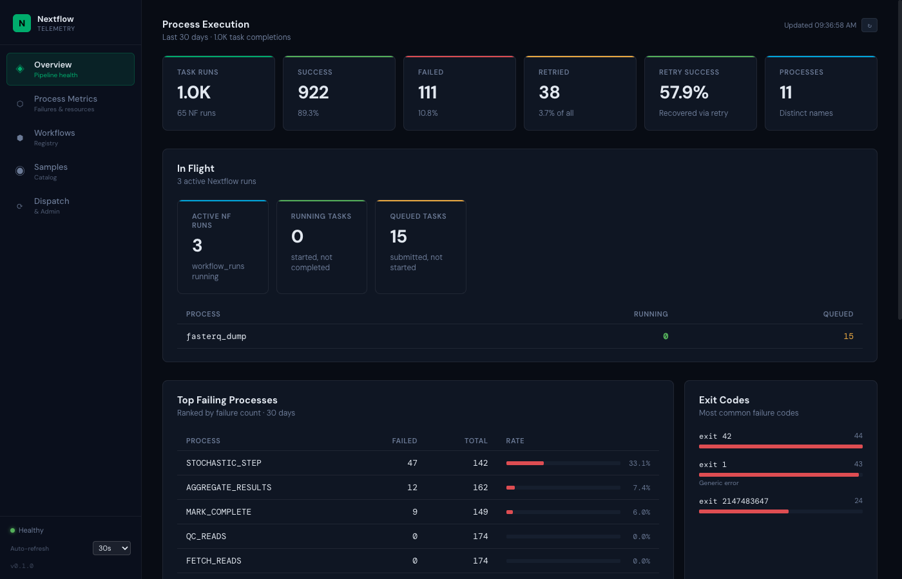
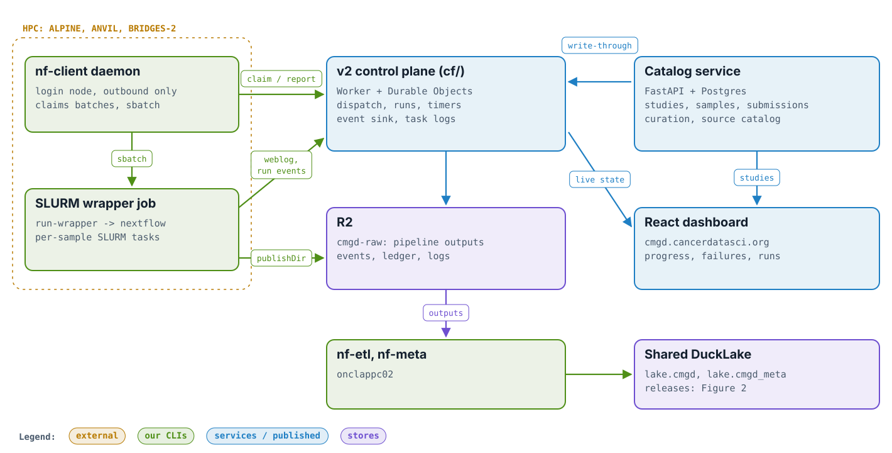
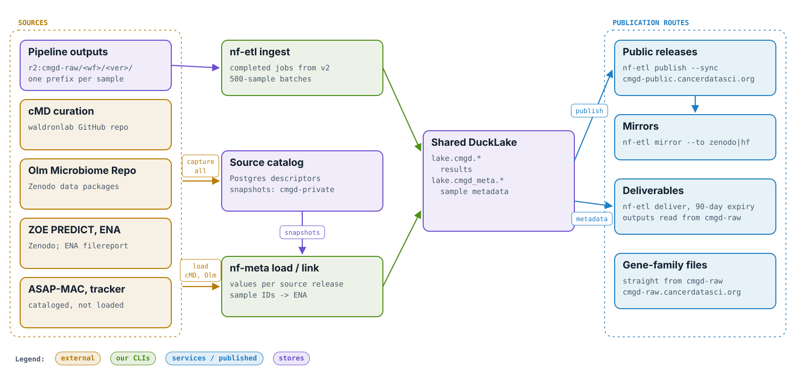

# Nextflow Telemetry

Orchestration, telemetry and data tooling for the curatedMetagenomicData (cMGD) compendium.
It dispatches the curatedMetagenomics Nextflow pipeline to HPC clusters, records every run
and task, shows progress on a live React dashboard, and turns pipeline outputs and sample
metadata into versioned, published data.

The repo has four parts:

| Part | Where | What it does |
|------|-------|--------------|
| **Control plane (v2)** | [`cf/`](cf/) | Cloudflare Worker + Durable Objects + R2. Dispatch, runs, timers, the event sink and task logs. Production. |
| **Catalog service** | `src/nextflow_telemetry/` | FastAPI + Postgres. Study and sample catalog, submissions, curated annotations, users and historical metrics ([ADR 0009](docs/adr/0009-catalog-in-postgres-control-plane-in-worker.md)). |
| **HPC client** | [`packages/nf_client/`](packages/nf_client/) | `nf-client` daemon on each cluster login node (Alpine, Anvil, Bridges-2). Claims batches and submits SLURM jobs. |
| **Data tooling** | `nf-etl`, `nf-meta` | Pipeline outputs and sample metadata into the shared DuckLake, public releases and deliverables. |

### Where to start

| If you want to... | Read |
|---|---|
| Add a study for processing | [Adding studies](docs/adding-studies.md): request an SRA study/BioProject by accession; maintainers review, approve and dispatch |
| Use the published data | [Data access](docs/data-access.md) |
| Run or debug the cluster daemons | [HPC deployment](docs/hpc-deployment.md), [HPC layout](docs/hpc-layout.md) |
| Work on the control plane | [`cf/README.md`](cf/README.md), [diagrams](cf/docs/diagrams.md) |
| Load outputs, publish, deliver | [nf-etl runbook](docs/etl-runbook.md) |
| Track metadata sources | [Metadata source catalog](docs/source-catalog.md) |
| Understand a design decision | [ADRs](docs/adr/README.md) and the [roadmap](docs/roadmap.md) |



---

## Dashboard

The dashboard is the primary interface for the cMGD team to monitor pipeline progress and
diagnose problems. It auto-refreshes every 30 seconds (configurable).

### Overview

The landing page gives a pipeline health summary for the last 30 days:

- **KPI cards** — total task runs, success rate, failure count, retry rate, and retry
  recovery rate across all Nextflow processes
- **In Flight** — live counts of tasks currently executing or queued in SLURM, broken down
  by process name. Updates each poll cycle so you can watch a batch progress in real time.
- **Top Failing Processes** — processes ranked by absolute failure count, with bar-chart
  failure rates. The most actionable view for triage.
- **Exit Codes** — frequency chart of the most common failure exit codes (e.g. 137 = OOM
  kill, 1 = generic error) to identify systemic resource or configuration problems.
- **Event Mix** — donut chart of raw Nextflow weblog event types (process_submitted,
  process_started, process_completed, etc.) — useful for spotting stalls.
- **Most Retried Processes** — processes that most often fail and get retried, with counts
  of how many retries ultimately recovered vs. exhausted all attempts.

### Process Metrics

Detailed task-level analytics with four tabs:

| Tab | What it shows |
|-----|--------------|
| **Failures** | Every process ranked by failure rate, with success/failure counts and most common exit code |
| **Retries** | Retry breakdown by attempt number and by process — how often does a second try succeed? |
| **Resources** | CPU and memory utilisation (average and P95) vs. what was requested, plus disk I/O |
| **Signatures** | Heatmap of (process × exit code) combinations — reveals whether a failure mode is process-specific or global |

### Workflows

Registry of pipeline versions. Each workflow card shows:

- Status (active / paused / retired) with colour coding
- A progress bar of jobs across the full sample queue: pending → running → completed / failed / dead-letter
- Configuration detail (repository, revision, profile, max retries) on expand

### Samples

Paginated catalog of all registered BioSample IDs with metadata and substring filtering by
sample_id or cohort.

### Studies

cMD study progress: one row per study, with progress under the active pipeline version
and study facets from the catalog. Collections that v2 knows but the study catalog does
not are marked with `*`.

### Cohorts

Collection-level summary (`/api/cohorts`) for any registered group of samples — a
BioProject, an SRA Study, or a manually-tagged cohort. Each cohort shows:

- Completion percentage and counts (pending / claimed / submitted / running / completed /
  failed) across the cohort's samples for a chosen workflow
- A failure-by-process bar chart: which Nextflow process is killing samples, and how many
- Click a process row to drill down to the failing task list, with deep-links into the
  log viewer

### Runs, Infrastructure, Dispatch & Admin

- **Runs**: workflow runs with a derived state, including how a run died
  ([ADR 0002](docs/adr/0002-run-death-classification.md)), and per-run detail.
- **Infrastructure**: the daemon fleet, active vs stale, from daemon heartbeats.
- **Dispatch & Admin**: operator buttons that make the live dispatch and admin calls
  (claim a batch, report submitted, requeue expired or dead-lettered jobs, reconcile).

---

## Key Concepts

**Sample** — a BioSample ID (e.g. `SAMN01234567`) plus associated NCBI accessions and
metadata. Each sample is processed once per active workflow version.

**Job** — one processing attempt for a (sample, workflow version) pair. Lifecycle:
`pending → claimed → submitted → running → completed | failed`. The gap between `submitted`
(executor accepted) and `running` (Nextflow actually started) is the scheduler queue
wait — kept separate so dashboards can distinguish a slow pipeline from a slow cluster.
A job can be retried up to `max_retries` times before being written to the dead-letter
table.

**Workflow run** — a single Nextflow execution that processes a batch of samples together.
The server dispatches runs in configurable batch sizes.

**Registration** — one pipeline version plus its configuration, e.g. `cmgd_mpa4.2/2.3.0`
([ADR 0010](docs/adr/0010-registrations-are-bundles.md)). Jobs, lake tables and public
datasets are all per registration.

**Readset id** — the stable sample key (`RS.…`) shared by v2, the catalog and the lake
([ADR 0007](docs/adr/0007-readset-identity.md)). The older md5 `sample_id` remains as an alias.

**Process metrics** — task-level data from individual Nextflow process executions
(`FETCH_READS`, `PROFILE_TAXA`, etc.). A sample's job can succeed even if some tasks failed
and were rescued by retry. Process metrics and job outcomes are complementary views.

**MARK\_COMPLETE** — the pipeline's completion sentinel. When the `MARK_COMPLETE` process
fires successfully for a sample, that sample's job is marked `completed`. If a run ends
without it, the job is failed (or re-queued if retries remain).

---

## Architecture

Concerns are split by job, not by era ([ADR 0009](docs/adr/0009-catalog-in-postgres-control-plane-in-worker.md)).
The v2 Worker runs the orchestration that needs timers and high write rates. The
Postgres catalog holds the metadata people query and curate. The two share one key, the
readset id ([ADR 0007](docs/adr/0007-readset-identity.md)).

<picture>
  <source media="(prefers-color-scheme: dark)" srcset="docs/figures/architecture-dark.svg">
  
</picture>

*Figure 1. System architecture. Amber: external (HPC clusters); green: our command-line tools; blue: services; violet: data stores. Generated by [`docs/figures/make_figures.py`](docs/figures/make_figures.py).*

**Data flow**

1. A study is requested by accession and approved ([Adding studies](docs/adding-studies.md)).
   The catalog registers its samples and writes them through to v2.
2. `nf-client`, running on each cluster's login node, claims batches of pending samples
   from v2 and submits a SLURM wrapper job per batch. It only makes outbound HTTPS calls
   ([ADR 0001](docs/adr/0001-pull-mode-orchestration.md)).
3. The wrapper (`nf_client.run_wrapper`) posts run-lifecycle events (`wrapper_started`,
   `pre_nextflow` with queue wait, heartbeats), then runs Nextflow.
4. Nextflow submits per-sample tasks to SLURM and posts weblog events as each task starts
   and finishes. Outputs are published to R2 ([ADR 0008](docs/adr/0008-object-storage-on-r2.md)).
5. When `MARK_COMPLETE` fires for a sample, v2 marks that job `completed`. If a run ends or
   its deadline passes without it, the job fails or is re-queued within the retry budget.
6. On exit the wrapper posts `wrapper_exited` and uploads `.nextflow.log`, so a run that
   dies before any weblog event is still diagnosable.
7. `nf-etl` loads finished outputs into the shared DuckLake and builds public releases;
   `nf-meta` loads sample metadata from cataloged sources
   ([ADR 0011](docs/adr/0011-results-storage-and-publication.md),
   [ADR 0012](docs/adr/0012-multi-source-sample-metadata-in-the-lake.md)).

**Storage**

| What | Where |
|------|-------|
| Jobs, runs, sample registry, daemons | v2 Durable Objects, with ledger snapshots in R2 |
| Raw Nextflow events | R2, as gzipped NDJSON partitioned by day; queried with DuckDB for history |
| Study/sample catalog, submissions, curation, users, metadata source catalog | Postgres `nf_telemetry` on the shared `pg_main` cluster |
| Pipeline outputs | R2 (`publishDir`) |
| Analysis tables (results and sample metadata) | shared cdsci DuckLake: catalog in Postgres, data in R2 |
| Original metadata source files | private R2 bucket `cmgd-private`, content-addressed |

The FastAPI app still contains the v1 dispatch, runs, daemon and process-metrics
endpoints. Production clusters and the dashboard use v2. ADR 0009 retires those v1
endpoints.

---

## Data sources and publication

<picture>
  <source media="(prefers-color-scheme: dark)" srcset="docs/figures/data-flow-dark.svg">
  
</picture>

*Figure 2. Data flow and publication routes. Pipeline outputs and metadata sources (left) are loaded into the shared DuckLake by `nf-etl` and `nf-meta` (middle), then published (right). Colours as in Figure 1.*

**Metadata sources.** Each upstream source is registered in the
[source catalog](docs/source-catalog.md). Its original files are kept byte-for-byte as
checksummed snapshots before anything interprets them. `nf-meta` then loads values per
source release into `lake.cmgd_meta`. The target schema is the cMD data dictionary,
pinned in `src/nextflow_telemetry/meta/schema/` with a generated LinkML schema
(`cmd.yaml`).

| Source | Loaded into the lake | Notes |
|---|---|---|
| curatedMetagenomicData curation | yes (`nf-meta load cmd`) | authoritative curated metadata; also defines the target schema |
| Olm Lab Microbiome Repo | yes (`nf-meta load olm`) | CC-BY-4.0 data packages from Zenodo |
| ZOE PREDICT open metadata | yes (`nf-meta load zoe`, `link zoe`) | CC-BY-4.0; sample IDs linked to ENA |
| ENA read-run listings | used for linkage | dated observations of a mutable source |
| ASAP-MAC Parkinson's curation and inventory | cataloged only | |
| Shared study tracker | cataloged only | restricted |

*Table 1. Metadata sources in the catalog as of 2026-10-19.*

**Publication routes.**

| Route | Command | What a consumer gets |
|---|---|---|
| Public releases | `nf-etl publish --sync` | Immutable, dated snapshots per registration (pipeline version + config) at <https://cmgd-public.cancerdatasci.org>: Parquet tables, a read-only DuckLake catalog, per-study downloads and provenance. See [Data access](docs/data-access.md). |
| Mirrors | `nf-etl mirror --to zenodo\|hf` | A built release copied to Zenodo (draft deposition, for a DOI) or Hugging Face. |
| Deliverables | `nf-etl deliver --sync` | A scoped, expiring hand-off for one requester: chosen collections, completed samples, wide TSVs plus METHODS.md. Not a release. |
| Gene-family files | (published with each HUMAnN release) | Per-sample HUMAnN gene families served straight from `cmgd-raw.cancerdatasci.org`, indexed in each release. |

*Table 2. Publication routes. Details in the [nf-etl runbook](docs/etl-runbook.md).*

---

## Command-line tools

| Tool | Runs on | Install | Does |
|---|---|---|---|
| `nf-client` | cluster login nodes, operator laptops | `uv pip install -e packages/nf_client` | Daemon that claims and submits batches; `run-wrapper` for SLURM jobs; operator commands (`stats`, `reconcile`, `requeue-dlq`, `register-workflow`); study registration (`submit-study`, `add-cmd`, `add-samples`, `submission`) |
| `nf-etl` | onclappc02 | `uv sync` (this repo) | Pipeline outputs into `lake.cmgd` (`status`, `ingest`, `tick`, `parse`, `volumes`) and the publication routes above (`publish`, `mirror`, `deliver`) |
| `nf-meta` | onclappc02 | `uv sync` (this repo) | Source catalog (`sources validate/apply/list/show/history/capture`), metadata loads (`load cmd/olm/zoe/xref`), linkage (`link zoe`), lake views (`views`) |
| `just` | anywhere | | Repo task runner: `just help` lists dev, deploy and data recipes (for example `just deploy-clients`, `just cmd-schema-pin`) |

*Table 3. Command-line tools. Each prints full usage with `--help`.*

`nf-etl` and `nf-meta` write to the shared cdsci DuckLake. With
`CU_OPENALEX_LAKE_BACKEND=postgres` they read the lake credentials from GCP Secret
Manager through `gcloud`. Without it they use a local file catalog for dev and tests.
`nf-meta sources` uses only the Postgres catalog (`SQLALCHEMY_URI`) and never opens the lake.

---

## Development

### Prerequisites

- Python 3.11+ with [uv](https://docs.astral.sh/uv/)
- Node 18+ with npm
- PostgreSQL (or use the Docker Compose stack)
- [just](https://github.com/casey/just) command runner

### Quick start

```bash
uv sync --group dev      # install Python dependencies
just up-db               # start PostgreSQL via Docker Compose
just migrate             # run Alembic migrations
just run                 # start the API server (hot reload)

cd frontend && npm install && npm run dev   # frontend dev server
```

### Common commands

```bash
just help       # list all commands
just check      # typecheck + tests
just ci         # full CI gate (sync --frozen + mypy + pytest)
just seed       # seed sample catalog from ArtachoA_2021_sample.tsv
```

### HTTP contract suite

`contract/` is a black-box pytest + httpx suite for the control-plane API (#372, ADR-0013
M2). It needs only a base URL and a token. It passes against a local v2 (the Worker in
`cf/` on miniflare), and the move to Postgres (M3) is done when it passes against the
Python service. Response shapes are checked against Pydantic mirrors of `cf/src/schemas.ts`.

```bash
just v2-local   # terminal A: local Worker with 6 s claim and liveness deadlines
just contract   # terminal B: the whole suite against it
```

| Variable | Default | Meaning |
|---|---|---|
| `CONTRACT_BASE_URL` | required | Origin root, no `/api`, no trailing slash |
| `CONTRACT_EVENT_URL` | `CONTRACT_BASE_URL` | Root that receives `/telemetry`, run events and task logs (the edge Worker after M5) |
| `CONTRACT_TOKEN` | unset | Bearer token for origin writes; enables `test_auth.py` |
| `CONTRACT_ALLOW_WRITES` | unset | `1` enables the tests marked `writes` |
| `CONTRACT_FAST_CLOCK_SECONDS` | unset | Longest time the target takes to fire any deadline; enables `test_timers.py` |
| `CONTRACT_EVENT_LAG_SECONDS` | `5` | How long to poll for state driven by an event |

Against production the suite is read-only: `CONTRACT_BASE_URL=https://nf-telemetry.seandavi.workers.dev uv run pytest contract`.
The write tier registers samples and runs `admin/reconcile-jobs` and `admin/requeue-dead-letter`,
which act on the whole catalog, so it needs a disposable target; the suite exits with
code 2 if `CONTRACT_ALLOW_WRITES=1` is set for a production host. CI runs the whole suite
against a local v2 on every PR (`.github/workflows/contract.yml`).

### API reference

Two APIs serve different concerns. The **v2 control plane** keeps the v1 wire paths for
dispatch, runs, telemetry, task logs, daemons and process metrics; its endpoint status is
in [`cf/README.md`](cf/README.md#endpoint-status). The **catalog service** (this FastAPI
app) has interactive OpenAPI docs at `/docs`. The table lists its routers. Production
clusters and the dashboard use v2 for the dispatch-side groups; the v1 copies retire
under [ADR 0009](docs/adr/0009-catalog-in-postgres-control-plane-in-worker.md).

| Group | Endpoints |
|-------|-----------|
| Telemetry ingest | `POST /telemetry` (Nextflow `-with-weblog`) |
| Run-lifecycle events | `POST /api/runs/{run_name}/event` (wrapper, pipeline hooks, daemon sacct polling) |
| Dispatch | `POST /dispatch/batch`, `/dispatch/submitted`, `/dispatch/requeue-expired` |
| Samples | `GET/POST /samples`, `GET /samples/{id}`, `GET /samples/by-srr/{srr}`, `GET /samples/by-biosample/{id}` |
| Workflows | `GET/POST /workflows`, `PATCH /workflows/{pk}/status`, `/revision`, `GET /workflows/{pk}/job-summary` |
| Cohorts | `GET /cohorts`, `/cohorts/{id}/summary`, `/cohorts/{id}/failures` |
| Process metrics | `GET /metrics/processes/running`, `/summary`, `/failures`, `/retries`, `/resources-by-attempt`, `/hosts`, `/failure-signatures`, `/timeline`, `/tasks` |
| Task logs | `POST /task-logs`, `GET /task-logs/{run_name}/{task_hash}` |
| Daemons | `GET /daemons/`, `POST /daemons/heartbeat` |
| Curated | `GET/POST /curated/studies`, `/curated/samples` |
| Admin | `POST /admin/reconcile-jobs`, `/admin/expire-stale-runs`, `GET /admin/stats` |
| Submissions | `POST /submissions` (study by accession), `GET /submissions/{submission_id}` |
| Auth | `GET /auth/login`, `/auth/callback`, `/auth/me`, `POST /auth/logout` (Google OAuth) |

### nf-client (HPC orchestration)

The `nf-client` CLI dispatches Nextflow runs against the server's job queue. It is only
needed by whoever operates the HPC submission daemon — not by dashboard consumers.

```bash
uv pip install -e packages/nf_client
nf-client daemon --config client-alpine.yaml
```

Daemons talk to the v2 control plane (`https://nf-telemetry.seandavi.workers.dev`).
`just deploy-clients [alpine|anvil|bridges2|all] [ref]` deploys them at a pushed commit.

The daemon's SLURM template invokes `python -m nf_client.run_wrapper` rather than
`nextflow run` directly. The wrapper emits run-lifecycle events (wrapper_started,
pre_nextflow with queue wait, periodic heartbeats, wrapper_exited with exit code and
`.nextflow.log` upload), all best-effort and incapable of failing the run. This makes
crashes visible end-to-end — including pre-Nextflow failures (module load, container
pull) that the weblog stream can't see.

For full Alpine / Anvil SLURM deployment details see
[docs/hpc-deployment.md](docs/hpc-deployment.md).

### Test pipeline

`nf_testing/main.nf` is a stub metagenomics pipeline (no real tools required) that
exercises the full telemetry contract. `v0.2.0` includes a `STOCHASTIC_STEP` that fails
with configurable probability (default 30%) to generate realistic retry telemetry.

---

## Production Deployment

The control plane runs on **Cloudflare** (the v2 Worker). The catalog service and the
dashboard run **self-hosted on `onclappc02`** as a Docker Compose stack behind the
shared Traefik reverse proxy on `cancerdatasci.org`, using the shared `pg_main` Postgres
cluster (one database per app — this app owns `nf_telemetry`). The migration off Cloud Run
+ Cloud SQL completed in May 2026.

| Component | Service |
|-----------|---------|
| Control plane (v2) | Cloudflare Worker `nf-telemetry.seandavi.workers.dev`, deployed from `cf/` with `npm run deploy` (see [`cf/README.md`](cf/README.md)) |
| Catalog service | `nf_telemetry_api` container, Traefik route `nf-telemetry.cancerdatasci.org` |
| Frontend | `nf_telemetry_frontend` container (nginx), Traefik route `cmgd.cancerdatasci.org` (Cloudflare-proxied); its API origin is the v2 Worker (`FRONTEND_API_URL`) |
| Data tooling | `nf-etl` / `nf-meta` on the host ([nf-etl runbook](docs/etl-runbook.md)) |
| Database | shared `pg_main` cluster, database `nf_telemetry` |
| Host | `onclappc02` (`140.226.4.71`) |

**The canonical runbook is [`deploy/onclappc02/README.md`](deploy/onclappc02/README.md)** —
first-time setup, secrets, DB topology, and the routine deploy. Read it before deploying.

### Routine deploy

From a checkout on `onclappc02`:

```bash
git checkout main && git pull          # the build context is the working tree
just deploy-onclappc02                  # fetch secrets → build API image → recycle container
```

`just deploy-onclappc02` refreshes `.env.secrets` from GCP Secret Manager, rebuilds the API
image from the working tree, and recreates the container (~30s of 503 while it restarts;
clients retry). Verify:

```bash
docker ps --filter name=nf_telemetry_api                # healthy?
curl -sS https://nf-telemetry.cancerdatasci.org/health   # 200
```

### Database migrations

Not run by the deploy target. If a change adds a migration, run it from the host first
(`pg_main` only resolves inside Docker, so use `127.0.0.1` from the host) — see the
runbook's migrations section.

### Secrets

Source of truth is **GCP Secret Manager** (project `cdsci-infra`). Two derived, gitignored
runtime files: `.env` (DB URI + hostnames) and `.env.secrets` (OAuth + session, generated
by `deploy/onclappc02/fetch-secrets.sh`). Never hand-maintain a parallel copy. Full table
and rotation steps are in the runbook.

> **Important — weblog URL stability:** the weblog URL (`-with-weblog <url>`, today the v2
> Worker) is baked into SLURM scripts at submission time. Changing that hostname mid-batch will silently
> drop telemetry for all in-flight jobs. Always keep the old hostname resolving (or
> redirect it) until all running Nextflow jobs have finished before cutting DNS over.
> The same goes for the wrapper events that `nf_client.run_wrapper` posts.

### CORS

The API reads allowed origins from the `CORS_ORIGINS` environment variable
(comma-separated), set via the compose `environment:` block to the frontend's domain:

```
CORS_ORIGINS=https://cmgd.cancerdatasci.org
```

Nextflow weblog POSTs and `nf_client.run_wrapper` events are server-to-server and are not
subject to CORS, so the HPC endpoint does not need to be in the allowlist.

### Legacy: Cloud Run + Cloud SQL (retired May 2026)

The stack originally ran on Cloud Run (`nf-telemetry`, us-central1) with Cloud SQL and
Firebase Hosting. That path is retired; the `just build-api` / `deploy-api` /
`deploy-frontend` recipes, `deploy/cloudrun.yaml`, and `cloudbuild.yaml` remain only for
historical reference and possible rollback while the GCP resources still exist (teardown
status tracked in `deploy/onclappc02/README.md`).
